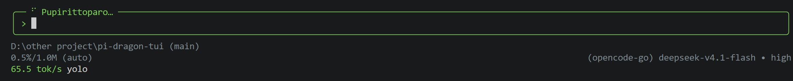

# pi-dragon-tui

[English](README.md) | **简体中文**

龙珠 / 那美克星风格的 pi 扩展：圆角编辑器边框、带框弹窗、那美克星语加载词，以及 tok/s 速度显示。



## 安装

```bash
pi install npm:pi-dragon-tui
# 或者
pi install git:github.com/oahcz-7891/pi-dragon-tui
```

重启 pi。之后修改代码用 `/reload` 即可。

## 功能

- **编辑器外框** — 圆角边框 + 金色的 `>` 提示符；自动换行的行会保持对齐缩进。边框颜色不受主题 / 思考等级 / bash 模式的影响。
- **弹窗** — 所有 `ctx.ui.custom()` 弹窗都套上同样的圆角边框，并去掉 pi 自带的全宽分隔线与按键提示底栏（想让它们保留，把 `ROUNDED_CONFIG` 里的 `stripInnerRules` 设为 `false`）。内置的 `select` / `confirm` / `input` / `editor` 不走 `custom()`，因此不会加框。
- **加载词** — "Working" 会轮换为那美克星语词汇（`Purunga…`）。
- **折叠的思考** — 在思考隐藏（`ctrl+T`）时，可以选择在 pi 的 `Thinking...` 标题下显示多少实时推理内容：`1 line`、`2 lines` 或 `hidden`。各行沿用 pi 的思考样式，并从尾部截断以保留最新内容，块结束后显示暗色的 `… (ctrl+t 展开)` 提示。展开状态下的思考不受影响。
- **TPS** — 状态栏显示 `48.2 tok/s`，颜色与边框一致。流式输出时显示当前消息的实时速度，生成结束后切换为会话平均值（输出 token ÷ 纯生成时间，已排除工具等待与首 token 延迟）。数值固定在当前会话中；pi 原生状态栏不受影响。
- **`/dragon`** — 设置菜单，可调边框颜色与折叠思考显示：`↑↓` 移动，`Space` 就地切换，`Esc` 关闭。

## 命令

```
/dragon                # 设置菜单
/dragon goku           # 悟空金      #f0c674  （默认）
/dragon vegeta         # 贝吉塔蓝    #7d9ed4
/dragon piccolo        # 比克绿      #7fc95a
/dragon thinking       # 循环：1 line → 2 lines → hidden
/dragon thinking 1|2|off
```


`gold` / `blue` / `green` 也可作为别名使用。选择会保存到 `<agent 目录>/.dragon-tui.json`（默认 `~/.pi/agent/`，可用 `$PI_CODING_AGENT_DIR` 或 `$PI_DRAGON_TUI_CONFIG` 覆盖），重启后依然生效。所有使用颜色的地方都读取同一个可变数据源，因此切换会在下一帧立即生效 —— 无需 `/reload`，输入框里已输入的文字也不会丢失。

## 配置

`index.ts` 顶部的常量：

- **提示符** — `BORDER_HEX`（边框颜色），`PROMPT_LEAD` / `PROMPT_GLYPH`（输入行前的空格与符号；设为 `""` 可关闭，也可用 `❯` / `›` / `▸`），`EDITOR_ROUNDED`，`ROUNDED_ENABLED`。
- **TPS** — `TPS_ENABLED`，`TPS_PREFIX` / `TPS_SUFFIX`（` tok/s`），`TPS_REFRESH_MS`。
- **思考 / 加载词** — `THINKING_MODE_DEFAULT`（`"line2"`），`THINKING_HINT`（块后后缀；`""` 隐藏），`WORKING_WORDS`，`WORKING_ROTATE_MS`。
